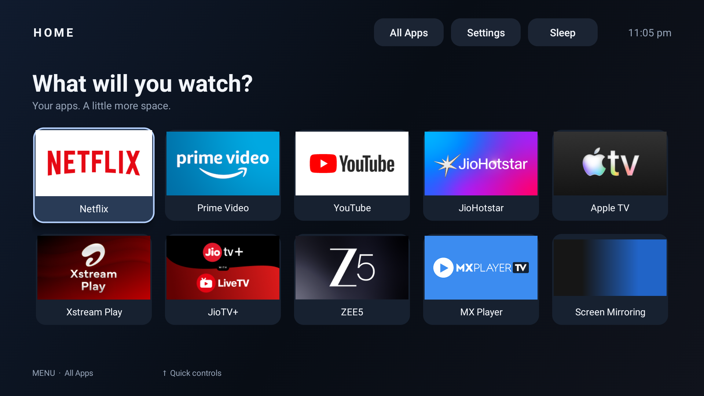

# Clear Home for Fire TV

A clean, native Fire TV home screen with your favourite apps, a visible Sleep button, and no advertising or recommendation feeds in the launcher.



**No root. No network permission in Clear Home. Your streaming apps and sign-ins stay installed.**

## What you get

- A dark app grid designed for a TV remote.
- Favourite selection: hold **OK** on an app to add or remove it.
- **All Apps**, direct Fire TV settings shortcuts, a clock, and one-click **Sleep**.
- Home-button and boot redirection through the separate [Home on Fire](https://github.com/toolicious/home-on-fire) project.
- A standalone Windows setup app that prepares Python and ADB automatically, discovers TV addresses and waits for TV approval.
- A cross-platform setup command with device checks, verified APKs, preserved accessibility services and local recovery backups.
- Optional shorter system animations, with restoration of their original values.

This changes the home screen. It does not remove advertisements inside Netflix, YouTube, Prime Video or other streaming apps. Amazon Home stays installed and may briefly appear during redirection. There is no claim of a measured CPU, internet-speed or playback-performance improvement.

## Compatibility

| Device software | Status |
| --- | --- |
| Fire OS 8 / Android 11 / API 30 | Tested on Amazon AFTKM (`karat`), Fire OS 8.1.8.5 |
| Fire OS 7 / Android 9 / API 28 | Installer accepts it; Clear Home has not been device-tested on it. Upstream Home on Fire reports support, with a Home-button delay of up to five seconds. |
| Fire OS 6 or older | Automatic setup refuses it |
| Vega OS | Not supported; this is an Android APK |
| Other Android / Google TVs | Not supported by this installer; Fire TV settings and Home redirection are platform-specific |

This is an early public release tested on one physical device, not a promise of universal Fire TV compatibility. See [verification](docs/VERIFICATION.md) and [upstream compatibility](https://github.com/toolicious/home-on-fire#compatibility).

## Quick start

### Windows: download one application

1. Download **[ClearHome-Windows-Setup.exe](https://github.com/Er-Arif/clear-home-fire-tv/releases/latest/download/ClearHome-Windows-Setup.exe)** and open it. No ZIP extraction, separate Python installation or PATH setup is needed.
2. On the TV, enable **Developer Options → ADB Debugging**. In **My Fire TV → About**, select the device name seven times if Developer Options is hidden. Keep the PC and TV on the same Wi-Fi.
3. Select **Install Clear Home**. It finds a single advertised ADB device automatically. Use **Find my TV** to choose from several devices, or enter the address from **My Fire TV → About → Network** if discovery is unavailable.
4. Accept **Allow USB debugging?** on the TV. Setup waits for up to two minutes and continues automatically when approval arrives.
5. On the TV, choose **Clear Home** in Home on Fire, then press Home.

The Windows application reuses compatible Python and ADB installations when found. Otherwise it downloads pinned tools from **python.org** and **dl.google.com**, verifies SHA-256 checksums, and prepares private copies under `%LOCALAPPDATA%\ClearHome\Tools`. It does not install Python globally, change PATH, require pip or request administrator privileges. Internet access is needed for missing tools and Home on Fire. Automatic Windows setup supports **Windows 10/11 x64**; other hosts can use the CLI below.

The release includes the signed Android APK from v0.2.0; v0.3.0 upgrades the host installer. The Windows executable is currently unsigned. Checksums are in the release; systems whose policy prohibits unsigned apps should use an approved deployment method rather than disabling security controls.

### macOS / Linux and command-line use

Install [Python 3.11+](https://www.python.org/downloads/) and Google's [Android Platform Tools](https://developer.android.com/tools/releases/platform-tools), and make `adb` available on PATH (or pass `--adb`). Download **ClearHome-Setup-v0.3.0.zip** from the [latest release](https://github.com/Er-Arif/clear-home-fire-tv/releases/latest) and extract it.

The ZIP also includes the Windows executable; `Setup.cmd` opens that application on Windows.

```bash
python3 setup.py install --device 192.168.1.50:5555
```

Replace the example address with your TV's address. On Windows use `py -3` instead of `python3`. Add `--wait-for-authorization` to wait for TV approval; otherwise approve the prompt and rerun if the first command stops.

The installer uses a bundled ClearHome.apk when available, otherwise downloads the pinned release. Home on Fire is downloaded from its developer's official release only if it is not already installed. Both APKs are checked against the SHA-256 values in `release-manifest.json`.

### Finish once on the TV

The installer opens **Home on Fire**:

1. Select **Choose target app → Clear Home**.
2. Keep **Replace Home button**, **Launch on boot**, and the **long-press Home escape** enabled.
3. Press Home. In Clear Home, open **All Apps** and hold OK on an app to choose favourites.

TV approval and this target selection are deliberate one-time manual steps. The script does not bypass the TV's authorization prompt or edit another app's private preferences. It never automatically reboots or puts the TV to sleep.

### Optional commands

```bash
# Inspect compatibility without downloading or changing settings
python3 setup.py install --device 192.168.1.50:5555 --dry-run

# Replicate the 0.5 animation timing used in the screenshot setup
python3 setup.py install --device 192.168.1.50:5555 --faster-animations

# Use an explicitly located ADB executable
python3 setup.py install --device 192.168.1.50:5555 --adb /path/to/platform-tools/adb

# Install just Clear Home and its Sleep service, without Home redirection
python3 setup.py install --device 192.168.1.50:5555 --no-home-redirect

# Check installed components and service state
python3 setup.py status --device 192.168.1.50:5555
```

On Windows use `py -3` instead of `python3`. The `--faster-animations` option shortens transitions; it is not an overclock or a benchmarked performance boost.

## Remote controls

| Control | Action |
| --- | --- |
| D-pad / OK | Navigate / open the selected app or button |
| Hold OK on an app | Add/remove a favourite; up to 30, in selection order |
| Menu | Switch between the main grid and All Apps |
| Back | Leave All Apps; on the main grid, return focus to the first app |
| Sleep button | Put the Fire TV stick into standby with one OK press |
| Home | Return to Clear Home when Home on Fire is configured; wake the stick |
| Hold Home | Escape to Amazon Home / quick settings through Home on Fire |
| Hold Menu | Open Home on Fire configuration |

Sleep is stick standby. Whether the television panel itself switches off depends on the television and HDMI-CEC; that behavior is not guaranteed. The initial favourites include common installed streaming apps; nothing is downloaded or subscribed to by the launcher. Use All Apps to choose a different selection.

## Undo

**Windows application:** reopen `ClearHome-Windows-Setup.exe`, select the same TV, then choose **Undo setup**. Its backups live at `%LOCALAPPDATA%\ClearHome\State` and are retained across installer upgrades. Keep that folder. This button restores setup changes without uninstalling apps.

**CLI:** keep the extracted setup folder, especially its hidden `.clear-home` directory. It contains the **first** settings backup for each device. Re-running setup keeps that original baseline. A new installation after a completed restore archives the previous record and takes a fresh baseline.

```bash
python3 setup.py restore --device 192.168.1.50:5555
```

To also remove apps that this installer added (never apps it found already installed):

```bash
python3 setup.py restore --device 192.168.1.50:5555 --remove-added-apps
```

Restoration removes only accessibility components added by this setup, keeps unrelated services added later, and restores animation values only when setup changed them. It does not roll back APK versions or app-private preferences. If Home on Fire was already active before setup, select its previous target on the TV yourself. [Recovery and troubleshooting](docs/RECOVERY.md) covers interrupted setup, lost backups and firmware changes.

## Download the APK only

Get **ClearHome.apk** and **SHA256SUMS.txt** from [Releases](https://github.com/Er-Arif/clear-home-fire-tv/releases). Installing the APK alone lets you open Clear Home as an app. Sleep needs its accessibility service, and Home/boot redirection needs Home on Fire. See [manual setup](docs/MANUAL_SETUP.md).

No streaming APKs or subscriptions are included. App icons are read from installed apps; the screenshot contains their owners' trademarks. Clear Home is not affiliated with Amazon, Apple, Google or the streaming services shown.

## Build, test and contribute

The app is native Java with Android SDK tools; setup is Python's standard library. No web server, account, database, analytics SDK or Python dependency installation is required.

```bash
python3 -m unittest discover -s tests -v
python3 tools/test_java.py
python3 tools/build.py --sdk /path/to/android-sdk --debug
```

Debug builds use a disposable signing key and cannot update the signed release. See [development](docs/DEVELOPMENT.md), [architecture](docs/ARCHITECTURE.md) and [contributing](CONTRIBUTING.md).

## Credits and license

Clear Home and its setup tools are **MIT licensed**. [Home on Fire](https://github.com/toolicious/home-on-fire) is a separate project by **toolicious**, licensed GPL-3.0-or-later. We download its unmodified official APK separately; its license and source remain upstream. Android Platform Tools are supplied by Google under their own terms. See [third-party notices](THIRD_PARTY_NOTICES.md).
